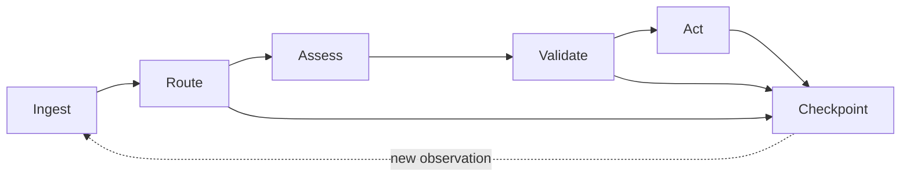

# Dwelly maintenance agent

A Node.js/TypeScript maintenance worker with an explicit state graph, durable SQLite events and action journal, a CLI, and a recording replay client. Opening a case records its remote ID; new evidence updates that case. It never sends a redundant landlord announcement.

## Run

Use Node **22.14.0** (`nvm use`). This version's native SQLite emits an experimental-feature warning.

```sh
npm ci
npm run build
npm test
npm run replay -- case-04
```

Replay is offline and scripted. It reads the real pinned case-04 tenant correspondence chronologically and shows a medium case opening followed by a high urgency update when damage downstairs becomes known. The synthetic event envelopes explicitly link the two tenants' reports; those links must be verified against the live feed. No future correspondence or final classification enters the scripted decision. The command prints the database, session, issue ID, full trace and exact inspect command.

```sh
DWELLY_SESSION_ID=<printed-session> DWELLY_DB=<printed-path> npm run inspect -- <issue-id>
```

## Live and evaluation

Load environment variables into your shell, using `.env.example` as a reference. Secrets are never CLI arguments. The CLI does not automatically load `.env`.

```sh
export DWELLY_SESSION_ID=interview-session-1
export DWELLY_BASE_URL=https://167.172.96.156.sslip.io
# Supply DWELLY_TOKEN and OPENAI_API_KEY through your secret manager or shell.
export OPENAI_MODEL=gpt-4.1-mini
npm run eval
npm run live
```

`eval` calls OpenAI only and makes no Dwelly mutations. It reserves cases 02, 05, 09 and 11, excludes their content and labels from guidance, supplies only initial observations, and reports expected/actual decisions, under-triage and failures. A nonzero exit signals failing expectations. Offline tests inject model responses; they are not real-provider evaluation results.

`live` loads authenticated `/history/cases`, drains durable work, and polls with the returned `next_cursor`. A two-second pause prevents empty-feed spinning. `DWELLY_DB` optionally overrides the database path. Each session must use separate state; a token fingerprint prevents a reset from silently resuming old remote IDs. Ctrl-C stops after the current operation.

## Workflow and recovery



Each event and poll cursor are saved together. Every write gets a durable intent before dispatch. A confirmed result, remote ID, issue state and completion are checkpointed together. Duplicate event delivery does not duplicate writes. An in-flight write after a crash becomes uncertain and holds dependent actions; there is no blind POST retry. A confirmed rate limit is deferred with bounded retries. Authentication failure stops the worker, and an ended session stops mutations. Unknown payloads and ambiguous routing remain in the audit trail.

A question waits for an attributable reply; material replies resume assessment. System echoes and plain acknowledgements do not send messages. Separate reports can create separate local issues at the same property. Model JSON is runtime validated against known evidence, actor and case IDs; malformed output gets one correction before review.

## Inputs and engineering notes

The API v1.0.0 and 15-case archive are pinned under `snapshots/2026-11-19/` with SHA-256 checksums. Public sources: [OpenAPI](https://167.172.96.156.sslip.io/openapi.json) and [history](https://167.172.96.156.sslip.io/history.json). Credentials always use HTTPS despite the spec's HTTP server example. Event payload keys are open-ended: `src/world/index.ts` centralizes supported aliases. Inspect live examples before relying on their meanings.

Dependencies: Zod validates network and model data; TypeScript and Node types support strict compilation. Native fetch and SQLite avoid extra runtime dependencies. See `docs/contracts.md`, the supplied `docs/build-strategy.md`, and `docs/agent-*.md` for boundaries and worker handoffs.

## Verification status

See `docs/verification.md` for the final executed checks and limitations. Real-provider evaluation and a live end-to-end run require credentials and are separate from offline replay evidence.
