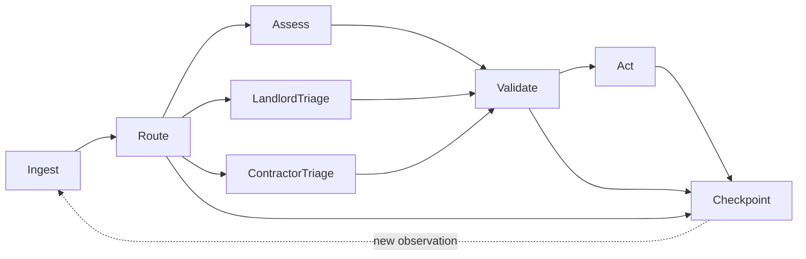

# Dwelly maintenance agent

A Node.js/TypeScript maintenance worker with an explicit state graph, durable SQLite events and action journal, a CLI, and a recording replay client. Opening a case records its remote ID; new evidence updates that case. It never sends a redundant landlord announcement.

## Run

Use Node **22.14.0** (`nvm use`). This version's native SQLite emits an experimental-feature warning.

```sh
npm ci
npm run build
npm test
npm run replay -- case-04
```

Replay is offline and scripted. It reads the real pinned case-04 tenant correspondence chronologically and shows a medium case opening followed by a high urgency update when damage downstairs becomes known. The synthetic event envelopes explicitly link the two tenants' reports; those links must be verified against the live feed. No future correspondence or final classification enters the scripted decision. The command prints the database, session, issue ID, full trace and exact inspect command.

```sh
DWELLY_SESSION_ID=<printed-session> DWELLY_DB=<printed-path> npm run inspect -- <issue-id>
```

## Live and evaluation

Load environment variables into your shell, using `.env.example` as a reference. Secrets are never CLI arguments. The CLI does not automatically load `.env`.

```sh
export DWELLY_SESSION_ID=interview-session-1
export DWELLY_BASE_URL=https://167.172.96.156.sslip.io
# Supply DWELLY_TOKEN and OPENROUTER_API_KEY through your secret manager or shell.
export MODEL_PROVIDER=openrouter
export OPENROUTER_MODEL=anthropic/claude-sonnet-5.5
npm run eval
npm run live
```

`eval` calls the configured model provider and makes no Dwelly mutations. It reserves cases 02, 05, 09 and 11, excludes their content and labels from guidance, supplies only initial observations, and reports expected/actual decisions, under-triage and failures. A nonzero exit signals failing expectations. Offline tests inject model responses; they are not real-provider evaluation results.

`live` loads authenticated `/history/cases`, drains durable work, and polls with the returned `next_cursor`. A two-second pause prevents empty-feed spinning. `DWELLY_DB` optionally overrides the database path. Each session must use separate state; a token fingerprint prevents a reset from silently resuming old remote IDs. Ctrl-C stops after the current operation.

## Workflow and recovery



Commands: `replay case-04` | `inspect <issue-id>|--review|--waiting` | `ack-wait <issue-id>` | `eval` / `eval-fresh` | `live` | `reconcile <action-id> <event-id>`. The `coordinate` command is retired; contractor coordination runs on the graph engagement path during live/replay.

Each event and poll cursor are saved together. Every write gets a durable intent before dispatch. A confirmed result, remote ID, issue state and completion are checkpointed together. Duplicate event delivery does not duplicate writes. An in-flight write after a crash becomes uncertain and holds dependent actions; there is no blind POST retry. A confirmed rate limit is deferred with bounded retries. Authentication failure stops the worker, and an ended session stops mutations. Unknown payloads and ambiguous routing remain in the audit trail.

A question waits for an attributable reply; material replies resume assessment. System echoes and plain acknowledgements do not send messages. Separate reports can create separate local issues at the same property. Model JSON is runtime validated against known evidence, actor and case IDs; malformed output gets one correction before review.

## Inputs and engineering notes

The API v1.0.0 and 15-case archive are pinned under `snapshots/2026-11-19/` with SHA-256 checksums. Public sources: [OpenAPI](https://167.172.96.156.sslip.io/openapi.json) and [history](https://167.172.96.156.sslip.io/history.json). Credentials always use HTTPS despite the spec's HTTP server example. Event payload keys are open-ended: `src/world/index.ts` centralizes supported aliases. Inspect live examples before relying on their meanings.

Dependencies: Zod validates network and model data; TypeScript and Node types support strict compilation. Native fetch and SQLite avoid extra runtime dependencies. See `docs/contracts.md`, the supplied `docs/build-strategy.md`, and `docs/agent-*.md` for boundaries and worker handoffs.

## Verification status

See `docs/verification.md` for the offline gate results. **Unverified until interview day** (do not report as done):

- Live rerun on a fresh Dwelly session
- Real-model `npm run eval` / `eval-fresh` on the v4 prompt (reserved cases 02/05/09/11 remain unmeasured for current-prompt accuracy)
- Contractor behaviour against real (non-fixture) correspondence

The labelled demo under-triage regression `demo-undertriage-2026-11-20` expects medium on turn 1; it does not claim a measured model score.

## Contractor coordination (graph-native)

Medium/high in-scope cases may propose one exact-trade contractor and send the landlord a single journaled briefing. Landlord and contractor natural-language mail drive quotes, approvals, work orders, tenant slot confirmation, visit confirmation and completion. Every remote effect is a journaled intent. `inspect` may still show legacy `coordination_*` rows from older databases (read-only).

See `docs/coordination-contract.md`. Offline graph fixtures cover decline/reassign, slot→confirm→complete, silence and changed-terms hold.

## Operator review

```sh
npm run inspect -- --review
npm run reconcile -- <action-id> <observed-event-id>
```

Both commands use the same `DWELLY_SESSION_ID` and database selection; reconciliation also requires the original token in `DWELLY_TOKEN` to verify the local binding. Reconciliation makes no remote write. Use it after inspecting a matching persisted system `case.created` (full `payload.case`) or `case.acknowledged` (title + urgency + `case_id`). Acknowledgements carry no description/property — uniqueness of the uncertain open intent plus title/urgency match is the safety property. A later cursor and unlinked remote ID are still required. If the live feed does not provide this evidence, leave the issue on review rather than retrying creation.

## OpenRouter evaluation

The evaluator also supports [OpenRouter Chat Completions](https://openrouter.ai/docs/api/reference/overview). Set `MODEL_PROVIDER=openrouter`, supply `OPENROUTER_API_KEY` securely in your shell, and set `OPENROUTER_MODEL` to your chosen full model ID (including its organization prefix). The documented interview default is `anthropic/claude-sonnet-5.5` (see `.env.example` and `docs/interview-handoff.md`). Then run `npm run build` and `npm run eval`. The same configuration works for live triage. The CLI does not read `.env` automatically.

OpenRouter model selection is explicit so evaluation does not silently choose a paid model. Output records the selected provider and model, never the key. All normal evidence/decision validation still applies. Provider support is tested with mocked requests and recorded real-model runs under `docs/diagnostics/`.

## Diagnose judgment versus graph failures

`npm run diagnose -- --saved` replays captured valid real-model decisions through the SQLite graph and recording client, including restart and duplicate delivery. `npm run diagnose -- <OpenRouter-model-id> ...` additionally makes paid evaluation calls with `OPENROUTER_API_KEY`, records exact redacted response/validation diagnostics, and checks both resulting decisions and raw rejected responses through the graph. Reports go to `docs/diagnostics/`; see `docs/diagnostics/findings.md`. Normal `npm run eval` also includes per-attempt diagnostics. Reports contain tenant observations and model text, so handle them as case data when using private live inputs.

## Assessment contract v2

The model now returns schema-constrained proposals without case or recipient IDs. Application code binds known IDs and enforces permitted actions, evidence and state. The single correction includes exact errors and the rejected response. Unsupported structured-output providers fail explicitly; there is no unconstrained fallback. Existing SQLite databases and internal decision journals remain compatible.

`npm run eval` separates provider failures, contract failures, actual under-triage and cases without scored urgency. `npm run eval-fresh` evaluates the frozen new synthetic scenarios with the same configured provider/model. `diagnose` now writes timestamped version directories under `docs/diagnostics/` rather than overwriting previous evidence.

See [assessment-v2.md](docs/assessment-v2.md) for the implementation, 103 passing offline tests and real-model results: 24/24 responses passed contract validation and graph replay; judgment still varied by model. Archive cases are regression tests, and the fresh synthetic set is not an independent external assessment.

## User-approved policy revision

The active prompt is now `triage-v4-scope-wait` (policy v1.1). These are **the user's prompt-policy changes, developed with the coding assistant in an attempt to improve accuracy—not an official Dwelly policy, instruction or endorsement**. See [the approval record](docs/policy/maintenance-policy-v1-approved.md) and `src/triage/policy.ts`. Attribution and policy version are recorded in evaluation reports and diagnostics.

The original archive cases and previously inspected synthetic scenarios are policy-conformance/regression tests, not independent hold-outs. The 24/24 contract results and model judgment scores above were obtained with v2; they do not establish accuracy for this new prompt. The v3 measurement is retained in `docs/policy/v3-model-comparison.md`. Current v4 results and 109 passing offline tests are documented in [scope and waiting results](docs/scope-wait-results.md).


## Scope and waiting reliability

The current model contract (`assessment-v3-scope-wait`) requires a scope label independently of urgency. Contradictory scope/actions are rejected. Stable cosmetic defects open one low-priority case under the user-approved policy; this does not commission work. Historical v2 proposal replays use a frozen adapter, and existing executable journals remain readable.

Set `DWELLY_REVIEW_AFTER_MS` to an explicitly chosen positive integer to schedule local operator review of waits. The live worker checks deadlines while polling; after a restart it checks overdue waits before processing new events. This is an operator-review interval, not a promised repair SLA. Without it, waits expose a configuration/review notice rather than assuming a deadline. Tenant replies must match the linked tenant; acknowledgements do not clear waits. Review expiry never triggers a remote write.

`npm run inspect -- --waiting` lists waiting items, including legacy waits without a recorded deadline. Stop the live worker before running `npm run ack-wait -- <issue-id>` with the original session/token binding. It acknowledges only a wait-specific review and refuses unresolved effects. It performs no remote write or immediate reassessment; new linked evidence resumes processing. Legacy waits without structured state require operator investigation and are not silently given invented deadlines.

`npm run eval-conversations -- <OpenRouter-model-id> 2` runs frozen synthetic conversations, two paraphrases and two repeats per scenario. It requires `OPENROUTER_API_KEY` and writes a timestamped report. Labels remain outside model context. Every turn exercises the full graph against a simulated World API, followed by restart and duplicate-delivery checks. Reports separate scope, urgency, action, provider/contract failure and graph execution, and retain returned usage and latency. They do not establish independent real-world accuracy or replace live-token verification.

Latest measurement: Claude Sonnet 5.5 and GPT-4.1 mini each passed all 24 synthetic conversation turns (20 urgency-scored), with no provider/contract errors and all graph/restart checks passing. See [the detailed report and limitations](docs/scope-wait-results.md).

## Interview dashboard

Run `npm run demo` and open **http://localhost:3000**. This small local interface shows archived incoming messages, actual graph traces, saved case state and simulated API actions. Step through the leak escalation, redeliver an event to demonstrate duplicate suppression, and reset for another walkthrough.

It uses the existing graph and SQLite with a **scripted assessor and simulated API**; no credentials are needed and no live records are changed. This is an explainer of execution, not a real-model accuracy demo. See [the walkthrough and design](docs/interview-demo.md). Use `PORT=3001 npm run demo` for a different port.

## Read-only live observer

Run the worker normally with `npm run live`. In a second terminal, from the same repository, set **the same** `DWELLY_SESSION_ID` and, if overridden for the worker, `DWELLY_DB`, then run:

```sh
export DWELLY_SESSION_ID=your-session-id
# Only if the worker uses an explicit path:
# export DWELLY_DB=/absolute/path/to/worker.sqlite
npm run observe
```

Open http://localhost:3000. If the demo is still using that port, run `PORT=3001 npm run observe` and open http://localhost:3001. The observer itself needs no Dwelly or model credentials and makes no external calls. It can also inspect a saved replay database using that replay's printed session and path.

It refreshes once per second with a read-only, transactional SQLite snapshot. It displays incoming events (including pending/system events), recorded graph steps, the current issue linked to the selected event, action journal states, and expandable coordination records. It follows new events while the latest event is selected; choosing an older event keeps your selection. Confirmed before/after comparisons are restricted to the linked issue. Queued, in-flight, failed and uncertain actions are labelled as journal entries rather than confirmed API writes.

Demo reset/delivery controls are hidden and all non-GET requests are rejected by the observer server. It does not take the writer lock, run recovery, change intents, advance the cursor, or reset state. Missing databases or session mismatches show a disconnected/error state and retry automatically; a last successful snapshot is retained and labelled stale. A database can remain readable after the worker stops, so connection status is **not a worker heartbeat**. Fast stages can complete between polls; the saved trace remains inspectable. This small local view returns the full session history; pagination would be needed for large production histories.

Validation: 112 tests passed, including simultaneous writer/observer access, in-progress assessment, uncommitted-write isolation, unchanged in-flight intents, session mismatch, read-only HTTP enforcement and recovery after database creation. JavaScript syntax checks pass; browser interaction automation was unavailable.

## Real-model interview demo

Use `npm run demo:llm` to replace scripted assessment with the existing structured-output model assessor. Dwelly actions remain simulated. Select a provider/model using the same environment configuration as live triage; keys remain on the server and are never sent to the browser.

```sh
export MODEL_PROVIDER=openrouter
export OPENROUTER_MODEL=anthropic/claude-sonnet-5.5
# Supply OPENROUTER_API_KEY securely in your shell, then:
PORT=3002 npm run demo:llm
```

Open http://localhost:3002. Delivering each archived message can make a paid model call (at most one correction attempt). The dashboard shows the configured model and expandable response/validation/timing/usage diagnostics. The frontend allows up to 100 seconds for processing; model requests have the existing 45-second per-attempt bound. Concurrent delivery/reset requests are rejected while processing. Redelivering a completed event does not reassess it. Reset clears demo state and diagnostics; delivering again after reset makes fresh calls.

No free-text input or deterministic result is promised: the model may ask questions or hold a case for review. The archive is a regression demonstration, not a blind evaluation. Provider errors and invalid output remain visible, with no scripted fallback. The simulated API never creates live Dwelly cases or sends actual messages. `npm run demo` remains the credential-free scripted mode; observer mode remains read-only.
