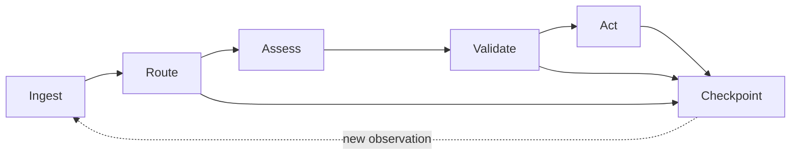

# Dwelly maintenance agent

A Node.js/TypeScript maintenance worker with an explicit state graph, durable SQLite events and action journal, a CLI, and a recording replay client. Opening a case records its remote ID; new evidence updates that case. It never sends a redundant landlord announcement.

## Run

Use Node **22.14.0** (`nvm use`). This version's native SQLite emits an experimental-feature warning.

```sh
npm ci
npm run build
npm test
npm run replay -- case-04
```

Replay is offline and scripted. It reads the real pinned case-04 tenant correspondence chronologically and shows a medium case opening followed by a high urgency update when damage downstairs becomes known. The synthetic event envelopes explicitly link the two tenants' reports; those links must be verified against the live feed. No future correspondence or final classification enters the scripted decision. The command prints the database, session, issue ID, full trace and exact inspect command.

```sh
DWELLY_SESSION_ID=<printed-session> DWELLY_DB=<printed-path> npm run inspect -- <issue-id>
```

## Live and evaluation

Load environment variables into your shell, using `.env.example` as a reference. Secrets are never CLI arguments. The CLI does not automatically load `.env`.

```sh
export DWELLY_SESSION_ID=interview-session-1
export DWELLY_BASE_URL=https://167.172.96.156.sslip.io
# Supply DWELLY_TOKEN and OPENAI_API_KEY through your secret manager or shell.
export OPENAI_MODEL=gpt-4.1-mini
npm run eval
npm run live
```

`eval` calls the configured model provider and makes no Dwelly mutations. It reserves cases 02, 05, 09 and 11, excludes their content and labels from guidance, supplies only initial observations, and reports expected/actual decisions, under-triage and failures. A nonzero exit signals failing expectations. Offline tests inject model responses; they are not real-provider evaluation results.

`live` loads authenticated `/history/cases`, drains durable work, and polls with the returned `next_cursor`. A two-second pause prevents empty-feed spinning. `DWELLY_DB` optionally overrides the database path. Each session must use separate state; a token fingerprint prevents a reset from silently resuming old remote IDs. Ctrl-C stops after the current operation.

## Workflow and recovery



Each event and poll cursor are saved together. Every write gets a durable intent before dispatch. A confirmed result, remote ID, issue state and completion are checkpointed together. Duplicate event delivery does not duplicate writes. An in-flight write after a crash becomes uncertain and holds dependent actions; there is no blind POST retry. A confirmed rate limit is deferred with bounded retries. Authentication failure stops the worker, and an ended session stops mutations. Unknown payloads and ambiguous routing remain in the audit trail.

A question waits for an attributable reply; material replies resume assessment. System echoes and plain acknowledgements do not send messages. Separate reports can create separate local issues at the same property. Model JSON is runtime validated against known evidence, actor and case IDs; malformed output gets one correction before review.

## Inputs and engineering notes

The API v1.0.0 and 15-case archive are pinned under `snapshots/2026-11-19/` with SHA-256 checksums. Public sources: [OpenAPI](https://167.172.96.156.sslip.io/openapi.json) and [history](https://167.172.96.156.sslip.io/history.json). Credentials always use HTTPS despite the spec's HTTP server example. Event payload keys are open-ended: `src/world/index.ts` centralizes supported aliases. Inspect live examples before relying on their meanings.

Dependencies: Zod validates network and model data; TypeScript and Node types support strict compilation. Native fetch and SQLite avoid extra runtime dependencies. See `docs/contracts.md`, the supplied `docs/build-strategy.md`, and `docs/agent-*.md` for boundaries and worker handoffs.

## Verification status

See `docs/verification.md` for the final executed checks and limitations. Real-provider evaluation and a live end-to-end run require credentials and are separate from offline replay evidence.

## Contractor extension

After inspecting a suitable open issue, stop the live worker (one writer per database), then explicitly select the trade and resume polling:

```sh
npm run coordinate -- <issue-id> plumbing
npm run live
```

This sends one work order to a current, explicitly available contractor. It waits for acceptance/decline, can reassign after decline, records quotes and landlord authority, waits for matching tenant/contractor appointment agreement, then waits for separate confirmation and completion. `inspect` includes coordination state, original events and action outcomes.

**The extension is verified with synthetic structured event fixtures.** Live correspondence extraction is not implemented: `coordination.*` event names and payload keys are local adapter conventions, not fields promised by the Dwelly API. They must be mapped from real, attributable observations before relying on this branch in a live session. Unknown payloads are held for review. Trade selection is explicit; availability accepts only clearly available values. Failed/uncertain coordination effects are held for review; unlike the MVP, extension rate limits do not automatically retry. It does not infer spending permission or place external calls. Changed appointments require human reconfirmation.

See `docs/coordination-contract.md` for exact fixture shapes and limitations. The last fully verified capability is the offline MVP plus deterministic extension scenarios; real-model judgment and live operation remain unverified.

## Operator review

```sh
npm run inspect -- --review
npm run reconcile -- <action-id> <observed-event-id>
```

Both commands use the same `DWELLY_SESSION_ID` and database selection; reconciliation also requires the original token in `DWELLY_TOKEN` to verify the local binding. Reconciliation makes no remote write. Use it only after inspecting a matching persisted system `case.created` event with a complete `payload.case`: the validator requires matching original fields, a later cursor, a unique uncertain intent and an unlinked remote ID. If the live feed does not provide this evidence, leave the issue on review rather than retrying creation. This is operator-confirmed association, not a server idempotency guarantee.

## OpenRouter evaluation

The evaluator also supports [OpenRouter Chat Completions](https://openrouter.ai/docs/api/reference/overview). Set `MODEL_PROVIDER=openrouter`, supply `OPENROUTER_API_KEY` securely in your shell, and set `OPENROUTER_MODEL` to your chosen full model ID (including its organization prefix). Then run `npm run build` and `npm run eval`. The same configuration works for live triage. The CLI does not read `.env` automatically.

OpenRouter model selection is explicit so evaluation does not silently choose a paid model. Output records the selected provider and model, never the key. All normal evidence/decision validation still applies. Provider support is tested with mocked requests; a real OpenRouter evaluation has not yet been run.

## Diagnose judgment versus graph failures

`npm run diagnose -- --saved` replays captured valid real-model decisions through the SQLite graph and recording client, including restart and duplicate delivery. `npm run diagnose -- <OpenRouter-model-id> ...` additionally makes paid evaluation calls with `OPENROUTER_API_KEY`, records exact redacted response/validation diagnostics, and checks both resulting decisions and raw rejected responses through the graph. Reports go to `docs/diagnostics/`; see `docs/diagnostics/findings.md`. Normal `npm run eval` also includes per-attempt diagnostics. Reports contain tenant observations and model text, so handle them as case data when using private live inputs.

## Assessment contract v2

The model now returns schema-constrained proposals without case or recipient IDs. Application code binds known IDs and enforces permitted actions, evidence and state. The single correction includes exact errors and the rejected response. Unsupported structured-output providers fail explicitly; there is no unconstrained fallback. Existing SQLite databases and internal decision journals remain compatible.

`npm run eval` separates provider failures, contract failures, actual under-triage and cases without scored urgency. `npm run eval-fresh` evaluates the frozen new synthetic scenarios with the same configured provider/model. `diagnose` now writes timestamped version directories under `docs/diagnostics/` rather than overwriting previous evidence.

See [assessment-v2.md](docs/assessment-v2.md) for the implementation, 103 passing offline tests and real-model results: 24/24 responses passed contract validation and graph replay; judgment still varied by model. Archive cases are regression tests, and the fresh synthetic set is not an independent external assessment.
