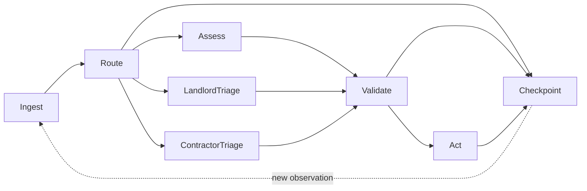
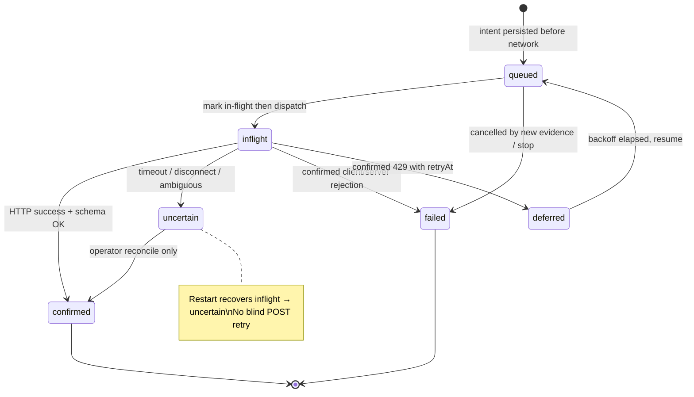
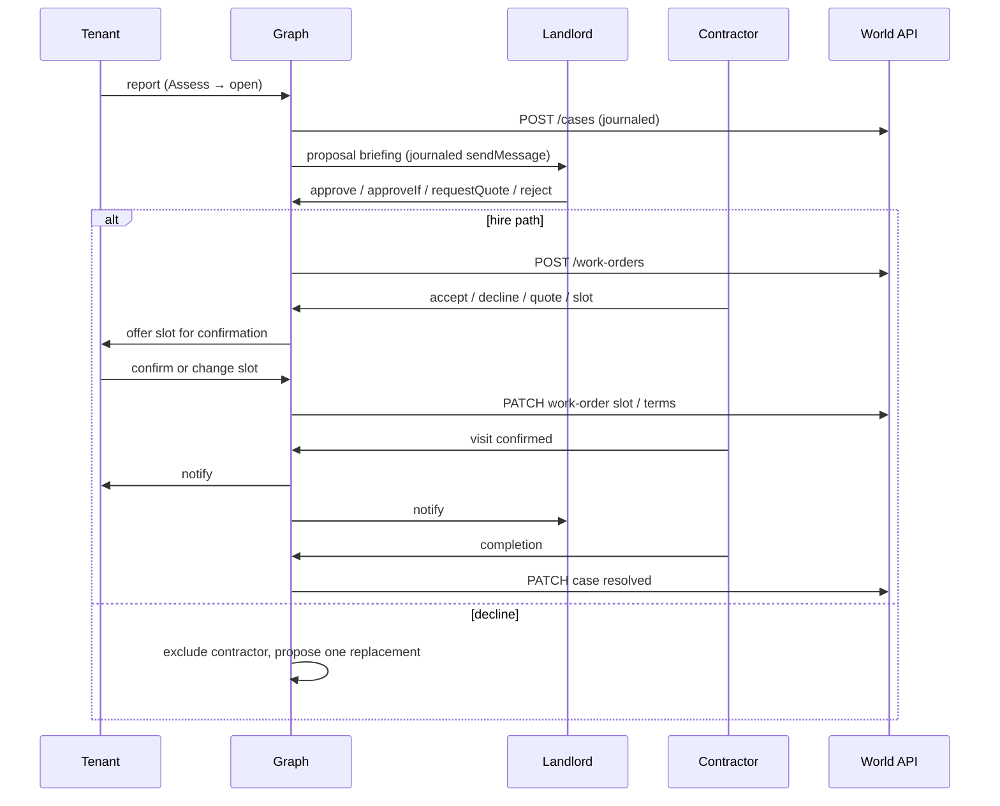
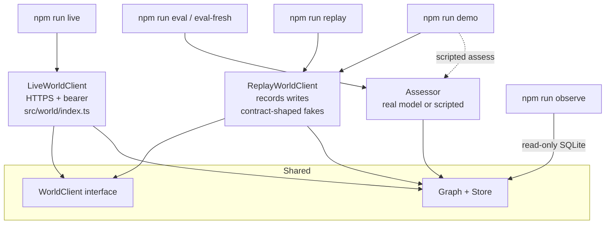

# Dwelly maintenance agent — interviewer handover

**Primary interview document.** Everything an interviewer needs to understand the product, the build path, the architecture, the proofs, and how to operate it for a 60-minute screen share. Intermediate briefs, diagnostics dumps, and layered verification appendices are intentionally out of the clean surface; this memo is the source of truth for narrative.

| | |
|---|---|
| Runtime | Node **22.14.0** (`.nvmrc`) |
| Stack | TypeScript, native `fetch`, native `node:sqlite`, Zod 4 |
| Offline gate | **184/184** tests + `npm run replay -- case-04` |
| Interview model | OpenRouter **`anthropic/claude-sonnet-5.5`** |
| Remaining interview-day blocker | Fresh `DWELLY_TOKEN` + a **new** `DWELLY_SESSION_ID` (do not reuse `interview-session-1`) |
| Pinned contract | `snapshots/2026-11-19/` (OpenAPI + 15-case archive, SHA-256) |
| HEAD theme at write time | Documented Sonnet default after model-compare evidence |

---

## 1. Product framing

### What it is

Dwelly is a **maintenance worker**, not a chat bot. It reads a simulation world’s event feed (tenant / landlord / contractor mail and system echoes), maintains local issues with durable evidence, decides the next justified action, and executes writes only through a typed world client. Opening a case records the remote ID; new evidence updates that case. Creating a case automatically informs the landlord once — the agent never sends a redundant landlord announcement for the same open.

It serves three audiences at once:

| Audience | What “good” looks like |
|---|---|
| **Tenant** | Report is linked to one local issue; a targeted question if needed; a case when evidence justifies it; no duplicate opens from redelivered mail |
| **Landlord** | One journaled proposal briefing after an in-scope open (not a second creation notice); natural-language approve / conditional / quote / reject drives work orders |
| **Operator (me, in the interview)** | Every edge is inspectable; uncertain writes hold for reconcile; restart does not invent a second POST |

### What a 60-minute screen share should show

1. **Offline plumbing** — `npm test` green, then `npm run replay -- case-04`: tiny contained leak opens medium (or low→update path depending on scripted assessor), later downstairs damage updates the **same** remote case to high; inspect the trace.
2. **Durability** — walk the action journal (`queued → inflight → confirmed`); show that duplicate delivery does not duplicate writes; show that an in-flight crash becomes `uncertain` with no blind retry.
3. **Judgment under contract** — model proposes schema-constrained decisions; application binds IDs; one correction then review.
4. **Live (if token ready)** — new session ID, `npm run live` + `npm run observe`; process real feed without reusing old SQLite / remote IDs.
5. **Honest limits** — under-triage is a judgment risk we measured; NL landlord/contractor classifiers are narrow by design; reconcile is operator-driven.

### Why an explicit state graph + durable journal beats a chatty agent

A conversational loop that “remembers” in the prompt is the wrong abstraction for maintenance operations:

- **Effects are irreversible and non-idempotent.** `POST /cases` always creates; there is no create idempotency key in the published API. A timeout after the server succeeded is a second case if you retry blindly. The journal forces *intent before dispatch* and *uncertain on unknown outcome*.
- **Cursored feeds and restarts are first-class.** Events and `next_cursor` land in one SQLite transaction. Unfinished events drain on restart. Chat memory does not survive process death; the store does.
- **Routing is multi-actor.** Tenant assessment, landlord triage, and contractor triage are different nodes with different classifiers and validators. Collapsing them into one free-form agent call mixes authority (who may approve spend) with observation (what the tenant said).
- **Traces answer “why.”** Each `TraceEntry` records session, event/cursor, local issue, remote ID, node, edge, evidence IDs, reason, and outcome. In the interview, the first wrong edge is findable without reading model chain-of-thought.

The model is a **judgment subroutine** inside `Assess`. The application owns IDs, permissions, writes, and recovery.

---

## 2. Contract-first start (2026-11-19)

Before any parallel implementation, I pinned the world contract and froze shared interfaces.

### Snapshots

| Artifact | Path | SHA-256 (prefix) |
|---|---|---|
| OpenAPI v1.0.0 | `snapshots/2026-11-19/openapi.json` | `6a2a02a9…` |
| 15-case history archive | `snapshots/2026-11-19/history.json` | `486eff7a…` |
| Checksums | `snapshots/2026-11-19/SHA256SUMS` | — |

Public sources (fetched 19 Nov 2026):

- https://167.172.96.156.sslip.io/openapi.json
- https://167.172.96.156.sslip.io/history.json

### HTTPS vs HTTP

The OpenAPI server example uses HTTP. Credentials always use **HTTPS** without URL-embedded userinfo. `LiveWorldClient` refuses non-HTTPS bases (`src/world/index.ts`). Bearer token lives in `DWELLY_TOKEN` / the environment — never in CLI args, traces, or git.

### Open payload keys

The event envelope is typed (`id`, `cursor`, `type`, `channel`, `actor`, `sim_ms`, `occurred_at`, `payload`). **Payload keys are open-ended.** Decoding aliases live in one place (`decodeEvent` in `src/world/index.ts`): `property_id` / `propertyId`, `reply_to_event_id` / `in_reply_to`, subject → `threadKey`, and so on. Unknown envelopes stay inspectable; they do not invent writes.

### Reserved eval cases

Before drafting prompts or rubrics:

```ts
// src/triage/index.ts
export const RESERVED_CASE_IDS = ['case-02', 'case-05', 'case-09', 'case-11'] as const;
```

Development and demos lean on **case-04** (worsening leak). Reserved IDs are excluded from model guidance/retrieval during evaluation. Their text and labels stay in the scorer. After inspection they became **regression** cases; fresh synthetics (`fixtures/assessment-v2-fresh.json`) were frozen before model calls as a separate acceptance set — still authored here, so not an independent external assessment.

### Shared interfaces before parallel work

Agreed in `src/types.ts` (and documented early in `docs/contracts.md` / the build brief):

| Interface | Role |
|---|---|
| `WorldClient` / `CoordinationWorldClient` | `poll`, `readHistory`, `createCase`, `patchCase`, `sendMessage`, plus contractors / work orders |
| `Assessor` | `(issue, evidence, precedents) → Decision` — **no writes** |
| `Decision` | Tagged union: ask / open / update / wait / outOfScope / review (+ scope fields in later contracts) |
| `processEvent` / graph entry | Shared path for live and replay |
| `TraceEntry` | Operator-facing “why did this change?” |

`LiveWorldClient` and `ReplayWorldClient` both implement the same client surface so tests and demos never special-case “fake API shape.”

---

## 3. Build process — chronology from git

Accurate to `git log` on `main` (dates local to the repo):

| Commit | Date | Theme |
|---|---|---|
| `62500df` | 2026-11-19 | **MVP** — durable graph, store, world, triage, replay/eval CLI, pinned snapshots |
| `1056d26` | 2026-11-19 | **Contractor extension** — coordination path, hardened recovery, CLI handoff, case-04 trace artifact |
| `02769e6` | 2026-11-19 | Clean-source verification recorded |
| `379f758` | 2026-11-19 | Model validation diagnostics; replay real decisions through durable graph |
| `183f736` | 2026-11-19 | **Assessment v2** — bind proposals to application state; structured contracts |
| `f0852ba` | 2026-11-19 | Separate eval failure classes; reserve fresh synthetic acceptance scenarios |
| `57785ca` | 2026-11-19 | Verify assessment v2 across real models; preserve regression evidence |
| `6d8a212` | 2026-11-19 | Clean-source assessment v2 rehearsal |
| `d896723` | 2026-11-19 | Activate user-approved prompt policy (explicit non-Dwelly attribution) |
| `503b77b` | 2026-11-19 | Measure user-policy v3 against saved v2 regressions |
| `ef598a3` | 2026-11-19 | Scope-wait / policy v4 integration (“final changes”) |
| `51c232c` | 2026-11-20 | **Live failure → brief-gap fixes** — thread routing, system events, landlord fan-out, graph engagement; freeze `interview-session-1` leaking-sink fixture |
| `6609ec1` | 2026-11-20 | **Retire Coordinator writer** — read-only legacy inspection; graph-native NL fixtures |
| `0d6ddaf` | 2026-11-20 | Demo under-triage regression + demos/observer; rewrite offline verification |
| `b65cf2c` | 2026-11-21 | Document **Claude Sonnet 5.5** as OpenRouter interview default |

### Narrative arc

**Bootstrap → parallel workers.** Lead owned package manifest, Node pin, snapshots, shared types, and CLI wiring. Three concurrent streams matched the brief:

| Stream | Ownership | Evidence in tree |
|---|---|---|
| API / world | `src/world/`, envelope validation, live + replay clients | `tests/world.test.ts` |
| Graph / store | `src/graph/`, `src/store/`, journal, routing, checkpoints | `tests/graph.test.ts` |
| Triage / eval | `src/triage/`, fixtures, reserved-case discipline | `tests/triage.test.ts`, eval CLI |

**MVP integrate (`62500df`).** One graph, both clients, scripted case-04 replay, offline tests without network/keys.

**Contractor extension (`1056d26`).** Work orders, directory selection, coordination tables — later superseded as the *write* path.

**Assessment v2 (`183f736`…`57785ca`).** Model stops inventing case/recipient IDs. Application binds known IDs; permissions gate allowed actions; one bounded correction with exact errors; unsupported structured-output providers fail visibly. Real-model runs: **24/24** initial responses passed contract validation and graph replay (judgment still varied by model — see §6).

**User policy + scope-wait (`d896723`…`ef598a3`).** Prompt `triage-v4-scope-wait` is a **user-approved policy revision developed with the coding assistant — not an official Dwelly policy**. Scope is labelled independently of urgency; contradictory scope/action pairs reject. Waiting gets structured local state and optional operator review deadline (`DWELLY_REVIEW_AFTER_MS`).

**Demos / observer (`0d6ddaf`).** Scripted dashboard (`npm run demo`), LLM demo (`demo:llm`), read-only live observer (`npm run observe`) sharing the writer’s SQLite snapshot without taking the lock.

**Live interview failure → brief-gap fixes (`51c232c`).** Captured session exposed gaps: `Re:` follow-ups not joining the active case, system `case.acknowledged` / `session.ended` under-spoken, plural landlord instructions needing fan-out, engagement needing to live on the graph. Fixture: `fixtures/live-leaking-sink-2026-11-20.json` + `tests/live-replay.test.ts`.

**Retire Coordinator writer (`6609ec1`).** Dual write paths were a liability. Coordination is graph-native natural language; `coordinate` CLI removed; legacy `coordination_*` rows remain readable for old DBs.

**Model selection (`b65cf2c`).** Tier-2 OpenRouter compare on 2026-11-21 → Sonnet 5.5 for interview live/eval (numbers in §6).

---

## 4. Architecture

### 4.1 Graph transitions

Source of truth: `transitions` in `src/graph/index.ts`.



| Node | Responsibility |
|---|---|
| **Ingest** | Persist event batch + `next_cursor` atomically; unique key session + event ID |
| **Route** | Actor / issue / purpose; ignore bare acknowledgements; system echoes; landlord vs contractor vs tenant; thread-key follow-ups |
| **Assess** | One structured model call over evidence + precedents (reserved cases excluded) |
| **LandlordTriage** / **ContractorTriage** | Regex classifiers + validators — **not** the model assessor |
| **Validate** | Shape, evidence IDs, known actors/cases, permitted transition, no-op detection |
| **Act** | Exactly one selected effect through the typed client; journaled |
| **Checkpoint** | Result + issue state + trace + event completion in one transaction |

### 4.2 Write journal lifecycle

Intent shape: `src/store/index.ts` — `state: 'queued' | 'inflight' | 'confirmed' | 'uncertain' | 'failed' | 'deferred'`.



Rules that matter in the interview:

1. **Intent before I/O.** No network without a durable queued row.
2. **Restart.** Any `inflight` becomes `uncertain`; issue → `review`; dependent writes hold.
3. **429.** Deferred with bounded retries; empty polls sleep (~2s) rather than spin.
4. **401 / session-ended 403.** Stop mutations; do not pretend success.
5. **Reconcile.** `npm run reconcile -- <action-id> <event-id>` binds an observed `case.created` / unambiguous `case.acknowledged` to the uncertain open intent — **zero remote writes**. Uniqueness of the uncertain open + title/urgency match is the safety property.

### 4.3 Engagement / coordination path

After an in-scope medium/high open, the graph may draft one exact-trade available contractor and send the landlord a **single journaled briefing** (distinct from case-create’s automatic notice). Thereafter NL mail drives the lifecycle:



Implemented in `src/triage/engagement.ts` + landlord/contractor classifiers, invoked from `src/graph/index.ts`. Booking ≠ visit confirmed ≠ completed. Changed quote/slot after a booked slot holds for **review** — never auto-patch `landlord_approved: false`. Silence writes nothing. At most one pending work order.

### 4.4 Live vs replay vs eval clients



| Mode | Network | Model | Mutates Dwelly |
|---|---|---|---|
| `npm test` | no | injected / scripted | no |
| `replay case-04` | no | scripted | no (recording client) |
| `eval` / `eval-fresh` | model provider only | real | **no** |
| `live` | Dwelly + model | real | **yes** |
| `demo` | no | scripted | no |
| `demo:llm` | model only | real | no (simulated API) |
| `observe` | no | none | no (read-only) |

---

## 5. Key design decisions

| Decision | Why (product + engineering) |
|---|---|
| **Application-bound IDs (assessment v2)** | Models invent UUID-shaped junk. Proposals carry no executable case/recipient IDs; `src/triage/proposal.ts` + `permissions.ts` bind known IDs after schema validation. Wrong ID never reaches the wire. |
| **One correction, then review** | Malformed JSON / semantic contract errors get exactly one repair pass with the rejected response and exact errors. Unbounded repair loops burn tokens and can thrash; review is the safe terminal. Transport failures do **not** trigger correction. |
| **No blind retry on uncertain writes** | API has no create idempotency key. Timeout after success ⇒ duplicate case / duplicate landlord mail. Uncertain + operator reconcile is slower and correct. |
| **Operator reconcile only** | Auto-matching on partial acknowledgements is unsafe (`case.acknowledged` lacks description/property). Uniqueness checks + optional full `case.created` payload; still zero remote writes. |
| **Regex landlord/contractor classifiers; model for tenant triage only** | Spend authority and booking semantics must be attributable and reproducible. Narrow regex over captured phrasings (`src/triage/landlord.ts`, `contractor-reply.ts`) beats a second model inventing approvals. Tenant urgency/scope is where judgment variance is worth the model. |
| **Retire Coordinator writer** | Two mutation paths (graph vs structured `coordination.*` writer) diverged under live pressure. One journaled engagement path; legacy tables read-only for old sessions (`6609ec1`). |
| **Subject / thread routing after live failure** | Live mail used `Re:` subjects without strong `issue_id` links. `normaliseThreadKey` strips Re:/Fwd: and joins follow-ups to the active same-actor issue (`51c232c`, `fixtures/live-leaking-sink-2026-11-20.json`). |
| **Session + token fingerprint on SQLite** | A reset token must not resume old cursors/case IDs. Binding mismatch fails closed; use a fresh DB / new `DWELLY_SESSION_ID`. |
| **One writer lock per DB** | Observer is read-only; second live worker refused. Prevents split-brain journals. |
| **Reserved eval cases before prompt drafting** | Prevents quietly overfitting the “held-out” set. After inspection they are labelled regressions; fresh synthetics carry the next acceptance burden. |
| **User policy attributed as non-Dwelly** | Honesty to interviewers: `triage-v4-scope-wait` is our attempt to improve accuracy, not official landlord policy (`src/triage/policy.ts`). |
| **Sonnet 5.5 for interview** | Measured under-triage risk on demo fixture: mini failed fresh demo-undertriage; Sonnet passed archive, fresh, and conversations urgency (see §6). Prefer reliability over mini’s cost/latency for a live screen share. |

---

## 6. How we proved it

### Offline gate (submit readiness)

Executed without live Dwelly writes:

```sh
nvm use          # 22.14.0
npm ci && npm run build && npm test   # 184 passed, 0 failed
npm run replay -- case-04             # one create, one same-case high update
```

Includes `tests/live-replay.test.ts` replaying the captured `interview-session-1` leaking-sink fixture through the real graph.

Historical offline counts (52 → 103 → 109 → 112 → **184**) grew with assessment v2, scope-wait, engagement, observer, and live-replay regressions. **184/184** is the current gate.

### Case-04

Canonical product story: early contained leak assessed without future knowledge; later downstairs damage updates the **same** remote case to high; exactly one creation; zero redundant landlord announcements. Trace inspectable via printed session/DB from replay.

### Live-leaking-sink fixture

`fixtures/live-leaking-sink-2026-11-20.json` freezes the real failure mode that drove `51c232c`. Offline regression proves thread routing, system event handling, and engagement behaviour without needing the live token again.

### Assessment v2 real-model evidence (2026-11-19)

Prompt `triage-v2`, contract `assessment-v2`, OpenRouter, **zero** Dwelly mutations:

| Model | Archive (02/05/09/11) | Fresh synthetics | Contract / provider failures |
|---|---:|---:|---|
| Claude Sonnet 5.5 | 4/4 | 4/4 | 0 / 0 |
| DeepSeek V3.1 | 2/4 | 2/4 | 0 / 0 |
| GPT-4.1 mini | 2/4 | 4/4 | 0 / 0 |

All **24** initial responses validated first attempt and replayed through the recording graph (restart + duplicate delivery). Graph pass ≠ judgment pass.

### Tier-2 model compare (2026-11-21) — interview choice

Prompt `triage-v4-scope-wait`. Evidence lived under `docs/diagnostics/model-compare-2026-11-21/` (gitignored as noisy intermediate; numbers below are the recorded recommendation):

| model | eval | fresh | demo-undertriage | conversations urgency | cost eval+fresh (USD) | latency eval+fresh (ms) |
|---|---|---|---|---|---:|---:|
| openai/gpt-4.1-mini (baseline) | 4/4 | 4/5 | **low (fail)** | 20/24 @ repeats=2 | n/a | n/a |
| **anthropic/claude-sonnet-5.5** | 4/4 | **5/5** | **medium (pass)** | **12/12** @ repeats=1 | 0.1259 | 36368 |
| openai/gpt-4.1 | 4/4 | 5/5 | medium (pass) | 11/12 (v0 under-triaged once) | 0.0530 | 19065 |
| deepseek/deepseek-chat-v3.1 | 4/4 | 4/5 | **low (fail)** | — | 0.0067 | 30430 |

**Recommendation:** interview live/eval model = **`anthropic/claude-sonnet-5.5`**. Runner-up gpt-4.1 is cheaper/faster but still under-triaged a conversations variant once. Single-run noise applies; no live Dwelly write in that compare.

### What remains interview-day

| Item | Status |
|---|---|
| Fresh `DWELLY_TOKEN` | **Required** — do not reuse exhausted/stale tokens |
| New `DWELLY_SESSION_ID` (+ separate SQLite) | **Required** — never reuse `interview-session-1` for a new live write |
| Live end-to-end on that fresh session | Unverified until performed |
| Contractor behaviour vs real non-fixture mail | Unverified (offline NL fixtures cover decline/slot/complete/silence/changed-terms) |
| Independent external judgment benchmark | Not claimed — archive is regression; fresh synthetics are internal |

---

## 7. Operator runbook

CLI does **not** auto-load `.env`. Export into the shell. Never put keys/tokens in committed files. Secrets and DBs: `.env`, `.data/` (gitignored).

### Offline (always first)

```bash
nvm use   # Node 22.14.0
npm ci && npm run build && npm test
npm run replay -- case-04
# Then, using printed session + DB:
# DWELLY_SESSION_ID=... DWELLY_DB=... npm run inspect -- <issue-id>
```

### Live start — Sonnet, **new** session only

```bash
export MODEL_PROVIDER=openrouter
export OPENROUTER_MODEL=anthropic/claude-sonnet-5.5
# OPENROUTER_API_KEY from secret manager
export DWELLY_SESSION_ID="interview-$(date -u +%Y%m%dT%H%M%SZ)"   # NEW — not interview-session-1
export DWELLY_TOKEN=...   # fresh token
# optional: export DWELLY_DB=".data/${DWELLY_SESSION_ID}.sqlite"
export DWELLY_BASE_URL=https://167.172.96.156.sslip.io
npm run live
```

### Observe (second terminal, same session / DB)

```bash
export DWELLY_SESSION_ID=...   # same as worker
# export DWELLY_DB=...          # if worker set an explicit path
npm run observe
# open http://localhost:3000 (or PORT=3001 if demo holds 3000)
```

### Inspect / waiting / reconcile

```bash
npm run inspect -- <issue-id>
npm run inspect -- --review
npm run inspect -- --waiting
# Stop the live worker first for ack-wait / reconcile:
npm run ack-wait -- <issue-id>
npm run reconcile -- <action-id> <observed-event-id>
# reconcile needs original DWELLY_TOKEN for binding check; no remote write
```

### Optional paid smoke (not required if offline is green)

```bash
export MODEL_PROVIDER=openrouter
export OPENROUTER_MODEL=anthropic/claude-sonnet-5.5
# OPENROUTER_API_KEY from secret manager
npm run eval
# npm run eval-fresh
```

### Demo (credential-free plumbing story)

```bash
npm run demo          # scripted assessor, simulated API → http://localhost:3000
# PORT=3002 MODEL_PROVIDER=openrouter OPENROUTER_MODEL=anthropic/claude-sonnet-5.5 npm run demo:llm
```

### Commands map

| Command | Purpose |
|---|---|
| `replay case-04` | Offline scripted product story |
| `inspect` / `--review` / `--waiting` | Trace, human holds, waits |
| `ack-wait` | Clear wait-review locally (no remote write) |
| `eval` / `eval-fresh` | Real model, no Dwelly mutations |
| `live` | Authenticated poll + mutate |
| `reconcile` | Bind uncertain open to observed event |
| `observe` | Read-only live dashboard |
| `diagnose -- --saved` | Replay captured valid decisions through graph |

`coordinate` is **retired**.

---

## 8. Honest limits (deliberate safety)

| Limit | Framing |
|---|---|
| **Judgment is stochastic** | Same prompt can under-triage (demo “tiny leak / no rush” → model says low; policy expects medium). We measure models and pick Sonnet for the interview; we do not claim deterministic urgency. Schema compliance ≠ correct maintenance judgment. |
| **Narrow NL classifiers** | Landlord/contractor regexes encode captured phrasings, not general NLP. Unparsed mail → ask / review, not invented approvals. Prefer missed automation over unauthorized spend. |
| **No auto-reconcile** | Uncertain writes stay visible until an operator confirms a unique match. Faster auto-heal is available in principle; it is the wrong default when `POST /cases` is non-idempotent. |
| **No invented spend / SLA** | Directory ratings and availability are inputs; budgets and visit promises come only from attributable messages. `DWELLY_REVIEW_AFTER_MS` is an operator-review interval, not a repair SLA. |
| **Observer ≠ heartbeat** | Read-only SQLite can look “connected” after the worker stops. Trace history remains the truth. |
| **Fresh token still required** | Offline 184/184 does not prove today’s live world. Interview day starts with a new session ID and a working bearer token. |

These are product choices: **prefer inspectable holds over silent wrong writes.**

---

## 9. Repository map (concrete paths)

| Path | Role |
|---|---|
| `src/graph/index.ts` | State graph, routing, dispatch, engagement hooks |
| `src/store/index.ts` | SQLite events, issues, intents, traces, reconcile, writer lock |
| `src/world/index.ts` | Live + replay clients, Zod contracts, payload decode, thread keys |
| `src/triage/index.ts` | Assessor wiring, reserved cases, validation entry |
| `src/triage/proposal.ts` / `proposal-v2.ts` / `validation.ts` / `permissions.ts` | Assessment contract |
| `src/triage/policy.ts` | Active user-approved prompt (`triage-v4-scope-wait`) |
| `src/triage/engagement.ts` | Graph-native contractor coordination plans |
| `src/triage/landlord.ts` / `contractor-reply.ts` / `directory.ts` | NL classifiers + contractor selection |
| `src/workflow/waiting.ts` | Wait state, expiry → review, ack-wait |
| `src/cli.ts` | Operator commands |
| `src/demo/server.ts` / `observer.ts` | Demo + read-only observer |
| `src/evaluation/*` | eval, diagnose, conversations |
| `src/types.ts` | Shared contracts |
| `snapshots/2026-11-19/` | Pinned OpenAPI + history |
| `fixtures/live-leaking-sink-2026-11-20.json` | Captured live regression |
| `fixtures/assessment-v2-fresh.json` | Frozen synthetics + demo-undertriage label |
| `web/demo/` | Local interview dashboard assets |
| `.env.example` | Variable names only — no secrets |

---

## 10. Closing

I built Dwelly as a **durable maintenance operator** with a judgment model inside a graph, not a conversational façade over HTTP. The interview story is: pin the contract, parallelise behind shared interfaces, prove restart and write uncertainty offline, bind model proposals to application state, learn from a real live failure (thread routing + engagement), collapse dual writers into one journaled path, measure models on the under-triage failure mode, and ship with Sonnet — while leaving reconcile and fresh live tokens as explicit human gates.

**Start here for the screen share:** §7 runbook → case-04 replay → inspect → (token ready) new session live + observe.
